<p align="center">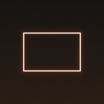</p>

<h1 align="center">Emulsion</h1>

<p align="center">A film camera for the iPhone 6s. RAW in, film out, developed on its own GPU darkroom.</p>

<p align="center"><code>iOS 15</code> <code>A9</code> <code>UIKit</code> <code>Core Image · Metal</code> <code>no jailbreak</code></p>

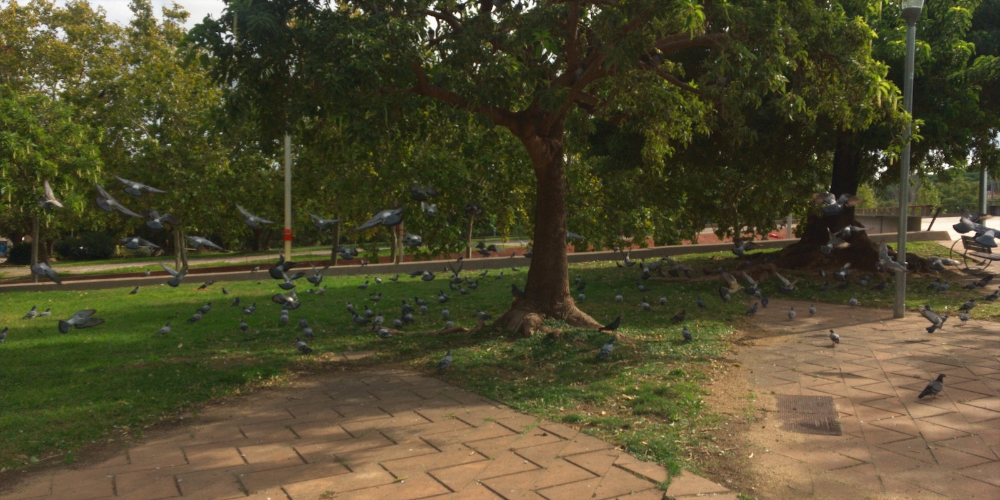

<p align="center"><sub><code>VELVIA 50</code> · ×1 · 28MM</sub></p>

## Stocks

Neutral gray prints neutral on every stock. The character is in how each one renders hue, contrast and grain.

<table>
<tr>
<td>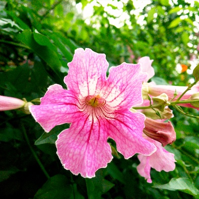<br><code>VELVIA 50</code></td>
<td>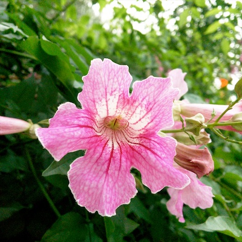<br><code>PROVIA 100F</code></td>
<td>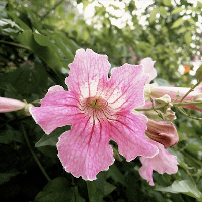<br><code>CHROME 64</code></td>
<td>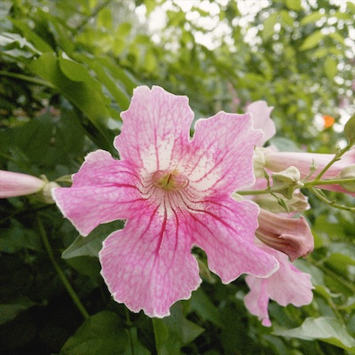<br><code>NEGATIVE 400</code></td>
<td>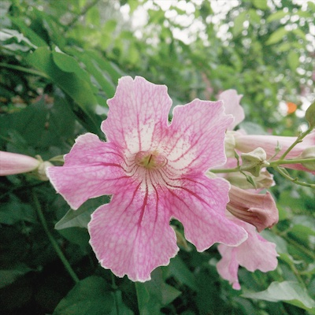<br><code>PRO 400H</code></td>
</tr>
<tr>
<td>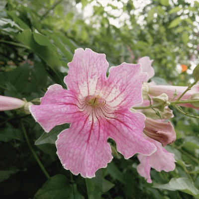<br><code>CINEMA 250D</code></td>
<td>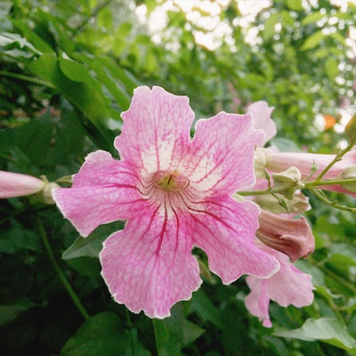<br><code>TUNGSTEN 800T</code></td>
<td>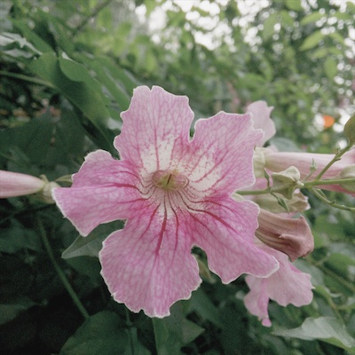<br><code>ETERNA 500T</code></td>
<td>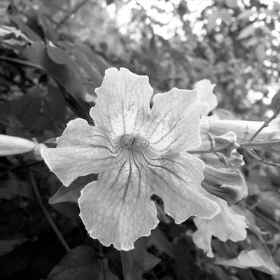<br><code>ACROS 100</code></td>
<td>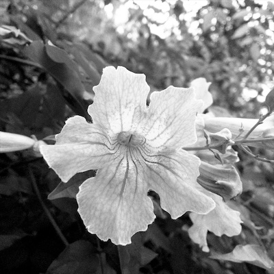<br><code>MONO 400</code></td>
</tr>
</table>

## Black and white filters

On ACROS and MONO, a contrast filter goes on before the conversion, while the RAW still has its color.

<table>
<tr>
<td><br><code>—</code></td>
<td>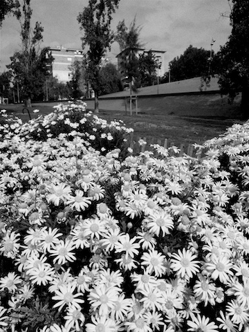<br><code>Y2</code></td>
<td>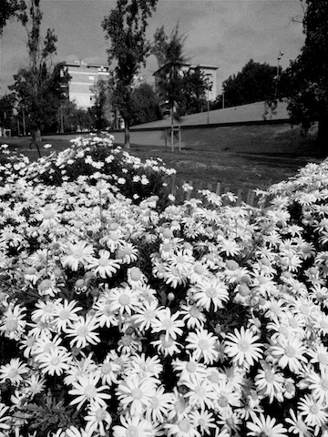<br><code>O</code></td>
<td>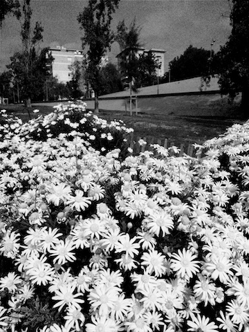<br><code>R25</code> darkens blue sky</td>
<td>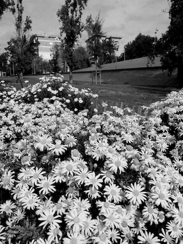<br><code>G</code> lightens foliage</td>
</tr>
</table>

## Darkroom

Apple's RAW pipeline is bypassed. Every frame is developed from the sensor's Bayer data.

| | |
|---|---|
| **Development** | LJ92 DNG decoder · Malvar–He–Cutler demosaic · the DNG's own color matrices, interpolated in mireds and adapted to D65 · lens vignetting from the DNG's opcodes · chroma-only noise reduction |
| **×4** | Four RAW frames merged: the light of an exposure two stops longer, handheld. Phase-correlation alignment (vDSP FFT, coarse to fine, sub-pixel), with Vision homography as a fallback. Low-pass agreement keeps moving things from ghosting. |
| **HDR** | A −2 / 0 / +2 RAW bracket merged into one frame |
| **35MM · 50MM** | A ×4 burst is rebuilt at full 12 MP from the hand's sub-pixel movement between frames, instead of a crop |
| **Film** | OKLab grading · per-stock tone curve baked into a 3D LUT · grain measured in stops · halation · Pro-Mist style diffusion (1/8, 1/4, 1/2) |
| **Speed** | ×4 in 2.1 s on the A9. The same burst through Apple's RAW filter took 8.7 s. |

## Video

| | |
|---|---|
| **Exposure** | Shutter priority at 180°, 90°, 45° or 360°. ISO follows the light, and exposure, white balance and focus lock for the take. |
| **Frames** | 24, 25 or 30 fps · 16:9, 1.85, 2.39 from the 4K mode · 1:1 from the full 4:3 sensor |
| **Super 8** | 4:3 at 18 fps, with 8 mm softness, grain and gate weave |
| **Virtual ND** | The sensor runs at 120 fps and frames are blended inside the shutter window, for motion blur in full sun |
| **Monitoring** | Zebras · focus peaking · magnifier · SMPTE timecode |
| **File** | H.264 tagged Rec. 709 at about 30 Mbps for 1080p · microphone without automatic gain |

## Camera

Manual focus on a distance scale, from 10 cm to ∞ · shutter speeds from 1/8000 to 1/3 s · EV by dragging the frame · 135, 645, 6×6 and XPAN frames · an 85 filter for tungsten stocks in daylight · pull one stop or push two · keep the DNG negative alongside the print

## Build

```sh
brew install xcodegen
xcodegen generate
open Emulsion.xcodeproj
```

Set `DEVELOPMENT_TEAM` in `project.yml` to your own team. A free Apple account works, but it has to re-sign the app every 7 days.

Tuned on one iPhone 6s. The color calibration is fitted to that sensor.

## Lab tools

Mac command-line tools that run the app's own darkroom code on DNGs, for tuning without the phone.

| | |
|---|---|
| `Tools/FilmLab` | every stock on your negatives, grain crops, B&W filters |
| `Tools/StackLab` | the real stacker on a burst, with timings |
| `Tools/RawLab` | the own developer against Apple's, by tone and color |

```sh
xcrun -sdk macosx swiftc -O Tools/FilmLab/main.swift Emulsion/Film/FilmStock.swift Emulsion/Film/FilmModel.swift -o build/filmlab
build/filmlab out/ negatives/*.dng
```
